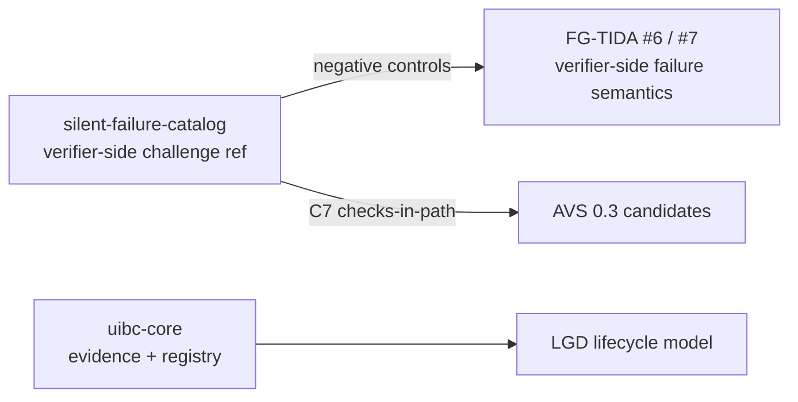

# Steven Zhao · China

> Independent expert building **machine-checkable, verifier-side primitives** — validation that **fails visibly** instead of passing silently.

**Why follow:** everything here is **falsifiable by construction** — every claim ships with a runnable reproduction and a negative control, so you can prove me wrong before you trust me. If you care about verifier-side failure semantics, agent governance, or how evidence survives context handoffs, this is the workshop.

## 🏛 Standards work · ITU-T Focus Group on TIDA

Work submitted to **[ITU-T FG-TIDA](https://www.itu.int/en/ITU-T/focusgroups/tida/Pages/Default.aspx)** (Trustworthy Identification for Autonomous Agents), written in an independent-expert capacity:

- **[`silent-failure-catalog`](https://github.com/zhaoxinghua09-cell/silent-failure-catalog)** → submitted as a verifier-side challenge reference in [`FG-TIDA/use-cases` PR #23](https://github.com/FG-TIDA/use-cases/pull/23): a named catalog of **14 silent-failure modes** — validation that passes while nothing is checked — each with a runnable reproduction, a fix, and a negative control. Zenodo-archived ([concept record 23051637](https://zenodo.org/records/23051637), resolves to the latest version); canonical release tag per the repo's citation note.
- **[Theme #7 — verifier-side requirements and failure semantics](https://github.com/FG-TIDA/themes/issues/7)**: discussion contributions on what a relying party may verify offline, and how verdicts stay re-verifiable without making every party a verifier. The catalog is also referenced in [theme #6](https://github.com/FG-TIDA/themes/issues/6) (intent-based security policies).
- **[`FG-TIDA/wg1-ra-aai` PR #2](https://github.com/FG-TIDA/wg1-ra-aai/pull/2)** — reference-architecture chapter 4: *offline re-verifiability* of agent attestation results, aligned with RFC 9334 (RATS) role separation.
- Merged: [`FG-TIDA/use-cases` PR #18](https://github.com/FG-TIDA/use-cases/pull/18) — completing the submissions index.

## 🧱 The stack · three layers, one idea

| Layer | Repos | One line |
|---|---|---|
| **Theory** | [lgd-theory](https://github.com/zhaoxinghua09-cell/lgd-theory) · [xlgd](https://github.com/zhaoxinghua09-cell/xlgd) · [xcgs-manifesto](https://github.com/zhaoxinghua09-cell/xcgs-manifesto) | Machine-checkable lifecycle model: registry · evidence · gates. |
| **Protocol** | [uibc-core](https://github.com/zhaoxinghua09-cell/uibc-core) · [uibc-competition](https://github.com/zhaoxinghua09-cell/uibc-competition) · [silent-failure-catalog](https://github.com/zhaoxinghua09-cell/silent-failure-catalog) · [assayance](https://github.com/zhaoxinghua09-cell/assayance) | Executable evidence/registry/validator core, the UIBC-MEM benchmark, and the verifier-side silent-failure challenge reference. |
| **Applications** | [medxpert-reg-kb](https://github.com/zhaoxinghua09-cell/medxpert-reg-kb) · [medxpert-reg-connector](https://github.com/zhaoxinghua09-cell/medxpert-reg-connector) · [medxpert-skills](https://github.com/zhaoxinghua09-cell/medxpert-skills) · [agent-skills](https://github.com/zhaoxinghua09-cell/agent-skills) · [agent-memory-service](https://github.com/zhaoxinghua09-cell/agent-memory-service) · [lgd-hub](https://github.com/zhaoxinghua09-cell/lgd-hub) | Product integrations: medical-device compliance tooling, agent skill packs, memory service, unified entry hub. |

Four names, four layers — used consistently: **XLGD** (umbrella · X is a distinction mark), **LGD** (theory), **UIBC** (executable protocol), **MedXpert** (medical-device compliance applications — parallel to, not inside, the umbrella). All four are project identifiers only — **no entity or trademark registration filed**.

## 📌 Pinned starting points

- 🔍 **New to the idea?** Start with [silent-failure-catalog](https://github.com/zhaoxinghua09-cell/silent-failure-catalog) — read one mode, run its repro, kill it with the fix.
- 🛠 **Building agent systems?** [uibc-core](https://github.com/zhaoxinghua09-cell/uibc-core) gives you registry / evidence / gates you can wire into your own lifecycle (Apache-2.0).
- 🏛 **Tracking FG-TIDA?** Watch this account — FG-TIDA submissions and follow-ups land here first.
- 🌐 **Prefer plain language?** [medxpert.cn](https://medxpert.cn) — the medical-device compliance line, in prose.

## 🤝 Get involved

- ⭐ Star or 👀 watch a repo if a mode / primitive saves you a bug — it tells me what to deepen next.
- 🐛 Found a claim that doesn't reproduce? That is the *best* issue to open. Negative controls are the house style.
- 💬 Ask me about verifier-side validation, agent evidence, or medical-device compliance tooling.
- ➕ **Follow** for standards-track work (ITU-T FG-TIDA), new silent-failure modes, and machine-checkable governance primitives.

## 📮 Contact

- Email: zhaoxinghua09@gmail.com
- ORCID: 0009-0001-0512-1237
- Site: <https://medxpert.cn>
- LinkedIn: <https://www.linkedin.com/in/steven-zhao-9156a197>
- X (Twitter): [@zhaoxing32035](https://x.com/zhaoxing32035)

All account content is **All Rights Reserved** (text, methodology, theory terms, specs, examples, scripts). Code is released under MIT / Apache-2.0 / AGPL-3.0 per repo. Attribution-only citation is permitted with named source + link + rights holder *Zhao Xinghua / Steven Zhao·China*.

**Brand status:** MedXpert, SynomosAI, LGD, UIBC, Nomos, XLGD are project identifiers only — **no entity or trademark registration filed**. Their appearance is source identification, not a claim of legal-entity or trademark rights.

---

*Maintained by the rights holder. Public information only; not legal, regulatory, or registration advice.*

---

# 中文说明

本账号聚焦于**可机器核验的验证方构件**——让校验在失效时可见，而不是静默通过。核心理念：**每一句声称都自带可运行复现与反向对照，先证伪、后采信**。

### 标准化工作 · ITU-T FG-TIDA

以独立专家身份向 **[ITU-T FG-TIDA（可自治智能体可信识别焦点组）](https://www.itu.int/en/ITU-T/focusgroups/tida/Pages/Default.aspx)** 提交的工作：

- **[silent-failure-catalog](https://github.com/zhaoxinghua09-cell/silent-failure-catalog)** —— 14 种"静默失败"模式的命名目录，每条含可运行复现、修法、反向对照。已作为验证方挑战参考实现提交（`FG-TIDA/use-cases` **[PR #23](https://github.com/FG-TIDA/use-cases/pull/23)**）；Zenodo 归档（概念记录 [23051637](https://zenodo.org/records/23051637)，解析到最新版本），规范引用 tag 以仓内引用注记为准。
- **[主题 #7 验证方失败语义](https://github.com/FG-TIDA/themes/issues/7)** 的讨论贡献（依赖方可离线核验什么、判决如何保持可复验而不把每个人都变成验证者）；catalog 亦被 [主题 #6](https://github.com/FG-TIDA/themes/issues/6)（意图安全策略）引用；**[`wg1-ra-aai` PR #2](https://github.com/FG-TIDA/wg1-ra-aai/pull/2)** 参考架构第 4 章：离线可复验性（对齐 RFC 9334 角色分离）。
- 已合并：[`use-cases` PR #18](https://github.com/FG-TIDA/use-cases/pull/18)（补全投稿索引）。

### 三层结构

**理论层**（lgd-theory · xlgd · xcgs-manifesto）→ **协议层**（uibc-core · uibc-competition · silent-failure-catalog · assayance）→ **应用层**（medxpert 系列 · agent-skills · agent-memory-service · lgd-hub）。

| 术语 | 层 | 含义 |
|---|---|---|
| **XLGD** | 伞 | 理论与协议线伞层标识；X 是区别符，用于标明来源 |
| **LGD** | 理论 | 全生命周期模型：凡自治之物，有籍·有证·有门禁 |
| **UIBC** | 协议 | 可执行协议：registry / evidence / gates 参考实现 + 基准 |
| **MedXpert** | 应用 | 医疗器械合规产品线——**与 XLGD 伞并行，不在伞内** |

### 参与方式

- 觉得某个模式帮你避了坑 → 给仓点 ⭐/👀，这决定我深挖哪条线。
- 发现哪句声称复现不了 → **开 issue，这是本仓最欢迎的贡献**（反向对照是本仓家风）。
- ➕ **关注本账号**：ITU-T FG-TIDA 标准线动态、新增静默失败模式、可机器核验的治理构件都会先落在这里。

### 联系

- 邮箱：zhaoxinghua09@gmail.com ｜ ORCID：0009-0001-0512-1237 ｜ 官网：<https://medxpert.cn>
- LinkedIn：<https://www.linkedin.com/in/steven-zhao-9156a197> ｜ X：[@zhaoxing32035](https://x.com/zhaoxing32035)

**权利宣告**：本账号全部内容保留所有权利；代码依各仓许可证（MIT/Apache-2.0/AGPL-3.0）使用。署名引用须标注权利人「赵兴华 / Steven Zhao·China」。MedXpert、SynomosAI、LGD、UIBC、XLGD 等仅为项目标识，**均未申请实体/商标注册**。
